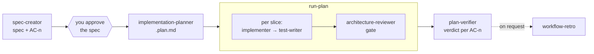

# sdd-engineering

Spec-driven development for Claude Code. A feature goes from a written spec
with numbered acceptance criteria (`AC-n`), to a plan whose every task cites a
criterion and a test, to code built slice by slice, to a verdict on every
criterion — and, when you ask, a retro on how the run went and what it cost.

The agents never commit, push or open pull requests. The `run-plan` skill
commits only when you approve it at its one gate.

## Components

### Agents

| Agent | Does |
|---|---|
| `sdd-engineering:spec-creator` | Writes one feature spec — the what and the why: blocking questions first, EARS acceptance criteria `AC-n`, `[NEEDS CLARIFICATION]` instead of assumptions. It does not finish a spec while any requirement lacks an AC (a Requirement coverage table proves it) |
| `sdd-engineering:implementation-planner` | Reviews an approved spec, then writes its `.plan.md` — the how and the order — in which every task cites an `AC-n` and a test |
| `sdd-engineering:implementer` | Builds a plan or one slice of it and proves it with the repo's own checks; reports deviations instead of hiding them |
| `sdd-engineering:test-writer` | Writes and runs the tests a slice names; writes test files only and reports source bugs rather than fixing them |
| `sdd-engineering:plan-verifier` | Read-only. Grades the finished diff against the spec and plan, one requirement at a time: Met, Partial, Missing, Deviated, Unverifiable or Deferred, with citations |

### Skills

| Skill | Does |
|---|---|
| `/sdd-engineering:run-plan` | Runs plan → build → review → verify for one approved spec, with one approval gate and a bounded rework budget |
| `/sdd-engineering:workflow-retro` | A retro on a finished run from the transcripts on disk: asked vs did, detours and drift, cost, at most three actions, one ledger row. Runs only when you invoke it |
| `/sdd-engineering:engineering-insights` | Reads the repo's `INSIGHTS.md` at the start of a task and proposes, with your approval, what the session learned back into it |

## How the pieces work together



1. Ask for a spec: "write a spec for …". `spec-creator` returns its blocking
   questions first, then writes the spec as `Status: draft`.
2. Approve it. `run-plan` asks if the spec is still a draft.
3. `/sdd-engineering:run-plan <spec path | SPEC-NN>` has
   `implementation-planner` write the plan, asks you once (in order or in
   parallel; commit per slice or not), then builds slice by slice: the
   implementer writes the source, the test-writer the tests the slice names.
   It runs the full check command, sends the diff to the reviewers it calls
   for, and has `plan-verifier` grade every criterion. A `CONFORMS` verdict
   sets the spec to `Status: implemented`.
4. At the end, `run-plan` runs `engineering-insights` with what the agents
   flagged, and tells you `/sdd-engineering:workflow-retro` is available.

Any step can be used on its own: spawn an agent directly, or run `run-plan`
on a spec you wrote with `spec-creator` in an earlier session. The plan file
is the run's state, so a stopped run resumes where it left off when you invoke
`run-plan` again.

## Inputs and defaults

Every component reads these from your repo's `CLAUDE.md` or `AGENTS.md`
first, and uses the default only when the repo says nothing.

| Input | Default |
|---|---|
| Spec directory | `.context/specs/`; per package `<package>/.context/specs/` when the repo has packages |
| Spec file name | `YYYY-MM-DD-feature-slug.md` with a `Spec ID: SPEC-NN` header |
| Plan file | Beside its spec, `<same name>.plan.md` |
| Check and test commands | Discovered, in this order: `CLAUDE.md` / `AGENTS.md` → `Makefile` targets → `package.json` scripts, or `go test ./...`, `pytest`, `cargo test` for those ecosystems |
| Architecture rules | The repo's architecture doc (`ARCHITECTURE.md`, `docs/architecture*`, the relevant section of `CLAUDE.md`), then its dependency-rule tool config, if any |
| Insights file | `.context/insights/INSIGHTS.md`; per package when the repo has packages |
| Retro ledger | `.context/retros/ledger.md` |

### When no test command is found

Nothing is invented. `run-plan` stops before the build and reports
`no test command found` with every place it searched. `implementer` stops
before editing and returns `BLOCKED` with the same message, and
`plan-verifier` runs nothing and says so. No check is ever reported as passed
that did not run. Add the command to `CLAUDE.md` / `AGENTS.md` (or a
`Makefile` target or `package.json` script) and run again.

## Outputs and where they land

| Output | Written by | Where |
|---|---|---|
| Spec | `spec-creator` | `<spec directory>/YYYY-MM-DD-feature-slug.md` |
| Plan | `implementation-planner` | Beside the spec, `<same name>.plan.md` |
| Source and tests | `implementer`, `test-writer` | Your working tree. Commits only with your approval at `run-plan`'s gate, one per slice |
| Spec status, task boxes, Commit column | `run-plan` | In the spec and plan files |
| Insights | `engineering-insights` | The insights file, only the entries you select |
| Retro row and actions | `workflow-retro` | The retro ledger, only the actions you select |

Everything stays in your repository. The plugin keeps no state of its own.

## Install

```bash
claude plugin marketplace add dmytrobereznii/dev-digest-ai-marketplace
claude plugin install sdd-engineering@dev-digest-ai-marketplace
```

Add `--scope project` to both to record the plugin in the project's
`.claude/settings.json` for the whole team. The dependencies below install
automatically. Then `/reload-plugins` or start a new session.

## Dependencies

| Plugin | Used for |
|---|---|
| `architecture-review` (`^1.0.0`) | `architecture-review:architecture-reviewer`, the independent review gate `run-plan` sends every source-changing diff to |
| `research-tools` (`^1.0.0`) | `research-tools:researcher`, which `run-plan` asks when a blocked agent needs a fact about a library or the running system |
| `engineering-paved-path` (`^1.0.0`) | Architecture and stack skills the agents load with the Skill tool when the change touches that stack |

### Optional, used if present

`run-plan` uses a `security-reviewer`, `brainstormer` or `doc-writer` agent
only if one is available in the session. Without one it skips that step and
says so in its report: security review is listed as skipped, a choice
between directions goes to you, and docs the plan names are listed as yours
to update.

## What it does not do

- It does not decide what to build. A spec comes from you, through
  `spec-creator`.
- It does not commit without your approval, push, open or merge pull
  requests, or run in CI.
- It does not invent a check or test command, or report an unrun check as
  passed.
- It does not review for bugs, security or repo-rule conformance. The
  architecture gate comes from `architecture-review`; a security review needs
  a separate agent.
- It does not run a retro on its own. `workflow-retro` runs only when invoked.
- It does not write insights or retro actions you did not select.
